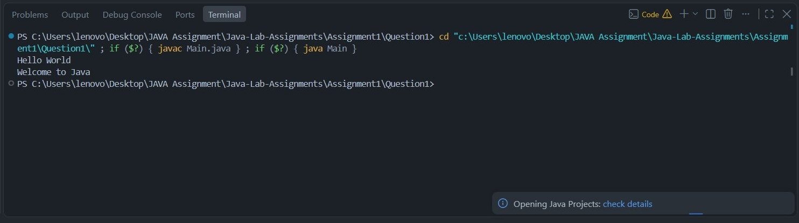
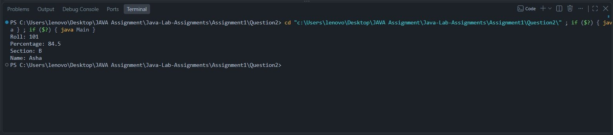
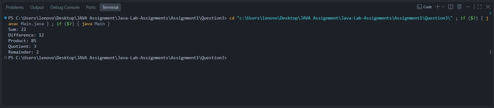
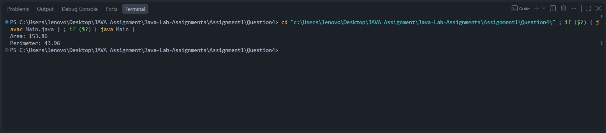

# Assignment 1: Hello World, Variables and Arithmetic

**Objective:** Print text, store values in variables and calculate with arithmetic operators.

**Tasks:** 4

## Questions

### Task 1: Question 1

Print Hello World on one line. Then print Welcome to Java on the next line.

- Java source: [`Task-01/Main.java`](Task-01/Main.java)
- Compiled bytecode: [`Task-01/Main.class`](Task-01/Main.class)
- Output image: [`Task-01/output.png`](Task-01/output.png)



### Task 2: Question 2

Create int roll = 101, double percentage = 84.5, char section = 'B' and String name = "Asha". Print each value on its own line, after the labels Roll:, Percentage:, Section: and Name: in that order.

- Java source: [`Task-02/Main.java`](Task-02/Main.java)
- Compiled bytecode: [`Task-02/Main.class`](Task-02/Main.class)
- Output image: [`Task-02/output.png`](Task-02/output.png)



### Task 3: Question 3

Create int variables a = 17 and b = 5. Print Sum:, Difference:, Product:, Quotient: and Remainder:, each followed by its result for a + b, a - b, a * b, a / b and a % b.

- Java source: [`Task-03/Main.java`](Task-03/Main.java)
- Compiled bytecode: [`Task-03/Main.class`](Task-03/Main.class)
- Output image: [`Task-03/output.png`](Task-03/output.png)



### Task 4: Question 4

Create a constant named PI with the final keyword and the value 3.14. For a circle with radius 7, print Area: followed by the area and Perimeter: followed by the perimeter, using PI.

- Java source: [`Task-04/Main.java`](Task-04/Main.java)
- Compiled bytecode: [`Task-04/Main.class`](Task-04/Main.class)
- Output image: [`Task-04/output.png`](Task-04/output.png)



## Run a task

Open the task folder (for example, `Task-01`) and run:

```sh
javac Main.java
java Main
```
