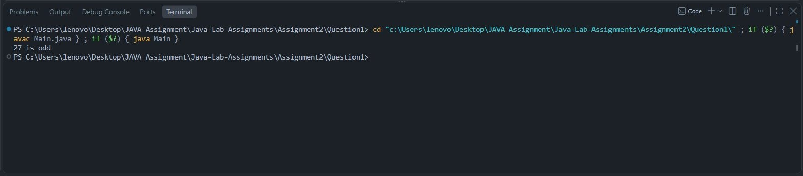
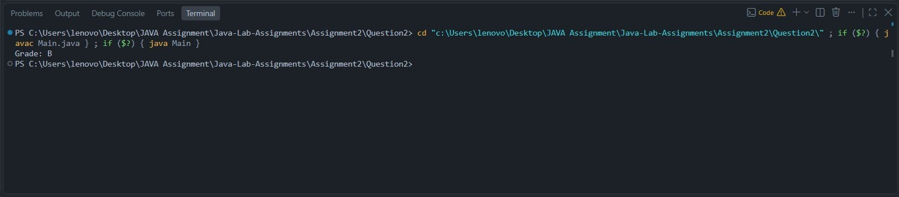
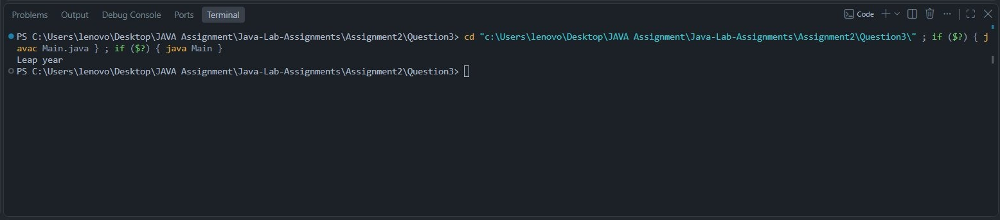
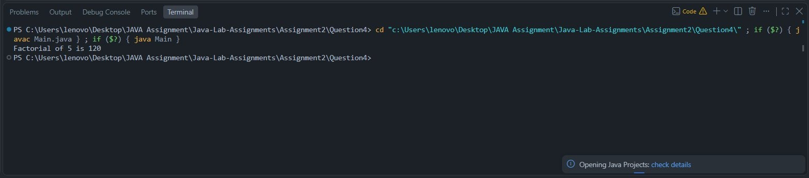

# Assignment 2: Decisions and Loops with Numbers

**Objective:** Use if, else if and loops to make decisions and repeat steps with whole numbers.

**Tasks:** 4

## Questions

### Task 1: Question 1

Store 27 in an int named n. Print the value of n followed by is even or is odd, using the % operator and an if-else statement.

- Java source: [`Task-01/Main.java`](Task-01/Main.java)
- Compiled bytecode: [`Task-01/Main.class`](Task-01/Main.class)
- Output image: [`Task-01/output.png`](Task-01/output.png)



### Task 2: Question 2

Store 83 in an int named marks. Print Grade: followed by A for 90 or more, B for 75 to 89, and C for less than 75. Use an else-if ladder.

- Java source: [`Task-02/Main.java`](Task-02/Main.java)
- Compiled bytecode: [`Task-02/Main.class`](Task-02/Main.class)
- Output image: [`Task-02/output.png`](Task-02/output.png)



### Task 3: Question 3

Store 2024 in an int named year. A leap year is divisible by 4 but not by 100, or divisible by 400. Print Leap year for a leap year, otherwise Not a leap year.

- Java source: [`Task-03/Main.java`](Task-03/Main.java)
- Compiled bytecode: [`Task-03/Main.class`](Task-03/Main.class)
- Output image: [`Task-03/output.png`](Task-03/output.png)



### Task 4: Question 4

Use a for loop to find the factorial of 5. Print Factorial of 5 is followed by the value.

- Java source: [`Task-04/Main.java`](Task-04/Main.java)
- Compiled bytecode: [`Task-04/Main.class`](Task-04/Main.class)
- Output image: [`Task-04/output.png`](Task-04/output.png)



## Run a task

Open the task folder (for example, `Task-01`) and run:

```sh
javac Main.java
java Main
```
