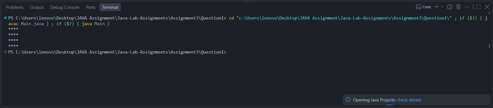
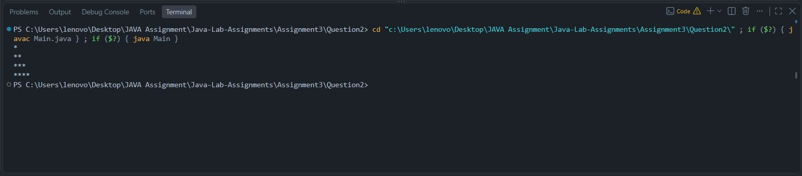
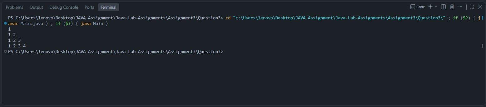
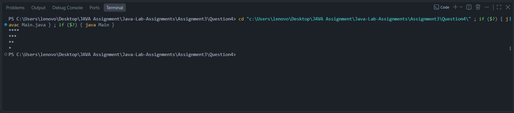

# Assignment 3: Star and Number Patterns

**Objective:** Use a loop inside another loop to print stars and numbers in rows.

**Tasks:** 4

## Questions

### Task 1: Question 1

Print a square of stars with 4 rows and 4 columns. Use one loop inside another loop.

- Java source: [`Task-01/Main.java`](Task-01/Main.java)
- Compiled bytecode: [`Task-01/Main.class`](Task-01/Main.class)
- Output image: [`Task-01/output.png`](Task-01/output.png)



### Task 2: Question 2

Print a right triangle of stars with 4 rows. Row 1 has one star, row 2 has two stars, and so on.

- Java source: [`Task-02/Main.java`](Task-02/Main.java)
- Compiled bytecode: [`Task-02/Main.class`](Task-02/Main.class)
- Output image: [`Task-02/output.png`](Task-02/output.png)



### Task 3: Question 3

Print a number triangle with 4 rows. Row 1 prints 1. Row 2 prints 1 2. Row 3 prints 1 2 3, and so on. Put a space after each number.

- Java source: [`Task-03/Main.java`](Task-03/Main.java)
- Compiled bytecode: [`Task-03/Main.class`](Task-03/Main.class)
- Output image: [`Task-03/output.png`](Task-03/output.png)



### Task 4: Question 4

Print an upside-down triangle of stars with 4 rows. Row 1 has four stars, row 2 has three stars, and so on, down to one star in row 4.

- Java source: [`Task-04/Main.java`](Task-04/Main.java)
- Compiled bytecode: [`Task-04/Main.class`](Task-04/Main.class)
- Output image: [`Task-04/output.png`](Task-04/output.png)



## Run a task

Open the task folder (for example, `Task-01`) and run:

```sh
javac Main.java
java Main
```
