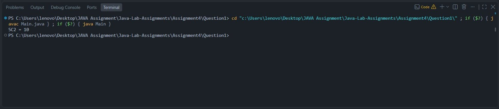
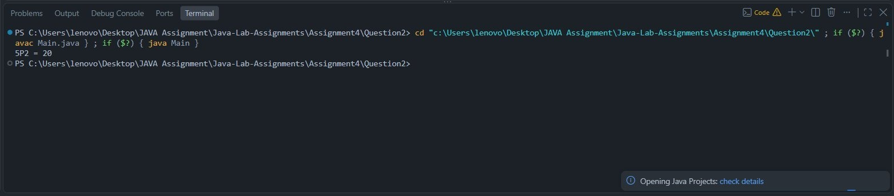
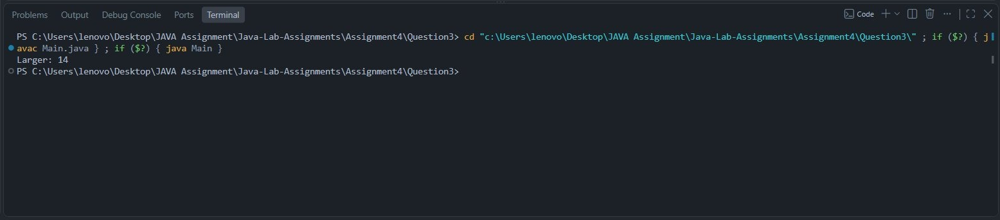

# Assignment 4: Writing Functions

**Objective:** Write functions with parameters and return values, and call them from main.

**Tasks:** 3

## Questions

### Task 1: Question 1

Write a function fact(int n) that returns n factorial, using a loop, and a function nCr(int n, int r) that returns n C r, using fact. In main, print 5C2 = followed by the result of nCr(5, 2).

- Java source: [`Task-01/Main.java`](Task-01/Main.java)
- Compiled bytecode: [`Task-01/Main.class`](Task-01/Main.class)
- Output image: [`Task-01/output.png`](Task-01/output.png)



### Task 2: Question 2

Write fact(int n) that returns n factorial using a loop, and nPr(int n, int r) that returns n P r using fact. In main, print 5P2 = followed by the result of nPr(5, 2).

- Java source: [`Task-02/Main.java`](Task-02/Main.java)
- Compiled bytecode: [`Task-02/Main.class`](Task-02/Main.class)
- Output image: [`Task-02/output.png`](Task-02/output.png)



### Task 3: Question 3

Write maxOf(int a, int b) that returns the larger of its two int values. In main, print Larger: followed by the result of maxOf(14, 9).

- Java source: [`Task-03/Main.java`](Task-03/Main.java)
- Compiled bytecode: [`Task-03/Main.class`](Task-03/Main.class)
- Output image: [`Task-03/output.png`](Task-03/output.png)



## Run a task

Open the task folder (for example, `Task-01`) and run:

```sh
javac Main.java
java Main
```
