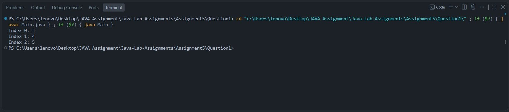
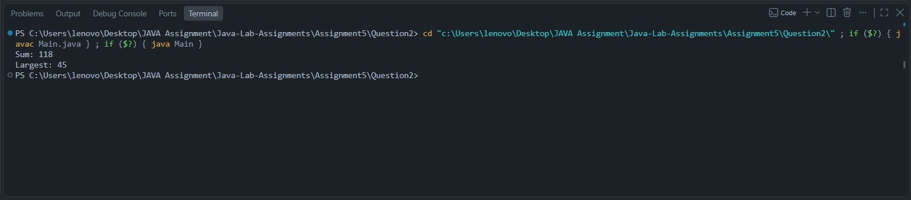
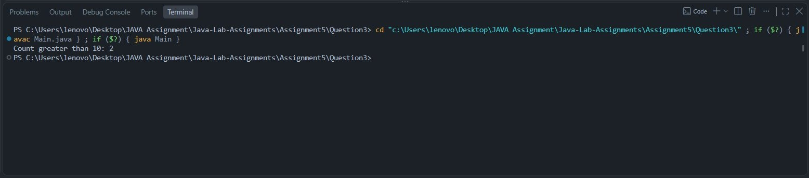

# Assignment 5: Arrays: Traversal and Counting

**Objective:** Create an array, visit every element with a loop, and add up or count the values.

**Tasks:** 3

## Questions

### Task 1: Question 1

Create an int array named arr with the values 3, 4 and 5. Use a for loop with arr.length to print one line for each element: the label Index, the index number, a colon and the element value.

- Java source: [`Task-01/Main.java`](Task-01/Main.java)
- Compiled bytecode: [`Task-01/Main.class`](Task-01/Main.class)
- Output image: [`Task-01/output.png`](Task-01/output.png)



### Task 2: Question 2

Create an int array with the values 12, 45, 7, 33 and 21. Use a loop to find the sum and the largest value. Print Sum: followed by the sum, then Largest: followed by the largest value.

- Java source: [`Task-02/Main.java`](Task-02/Main.java)
- Compiled bytecode: [`Task-02/Main.class`](Task-02/Main.class)
- Output image: [`Task-02/output.png`](Task-02/output.png)



### Task 3: Question 3

Create an int array with the values 5, 12, 2, 14 and 7. Use a loop to count the values greater than 10. Print Count greater than 10: followed by the count.

- Java source: [`Task-03/Main.java`](Task-03/Main.java)
- Compiled bytecode: [`Task-03/Main.class`](Task-03/Main.class)
- Output image: [`Task-03/output.png`](Task-03/output.png)



## Run a task

Open the task folder (for example, `Task-01`) and run:

```sh
javac Main.java
java Main
```
