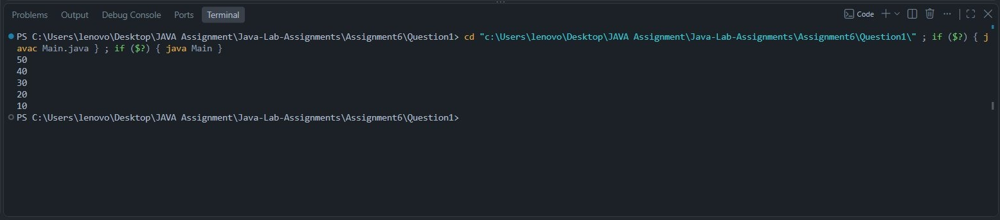
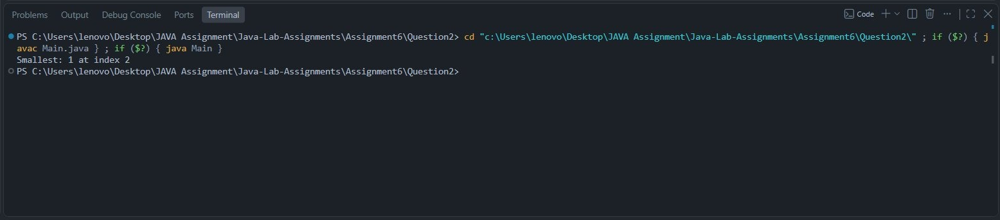
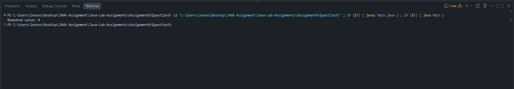

# Assignment 6: Arrays: Reverse and Duplicates

**Objective:** Print an array in reverse order, find the smallest value, and check an array for repeated values.

**Tasks:** 3

## Questions

### Task 1: Question 1

Create an int array with the values 10, 20, 30, 40 and 50. Print the values in reverse order, one value on each line, starting with the last value.

- Java source: [`Task-01/Main.java`](Task-01/Main.java)
- Compiled bytecode: [`Task-01/Main.class`](Task-01/Main.class)
- Output image: [`Task-01/output.png`](Task-01/output.png)



### Task 2: Question 2

Create an int array with the values 2, 5, 1, 8, 3 and 4. Use a loop to find the smallest value and its index. Print Smallest: followed by the value, then the words at index and the index.

- Java source: [`Task-02/Main.java`](Task-02/Main.java)
- Compiled bytecode: [`Task-02/Main.class`](Task-02/Main.class)
- Output image: [`Task-02/output.png`](Task-02/output.png)



### Task 3: Question 3

Create an int array with the values 4, 9, 2, 9 and 7. Use nested loops to check for a repeated value. Print Repeated value: followed by it, or print No repeated value if none is repeated.

- Java source: [`Task-03/Main.java`](Task-03/Main.java)
- Compiled bytecode: [`Task-03/Main.class`](Task-03/Main.class)
- Output image: [`Task-03/output.png`](Task-03/output.png)



## Run a task

Open the task folder (for example, `Task-01`) and run:

```sh
javac Main.java
java Main
```
