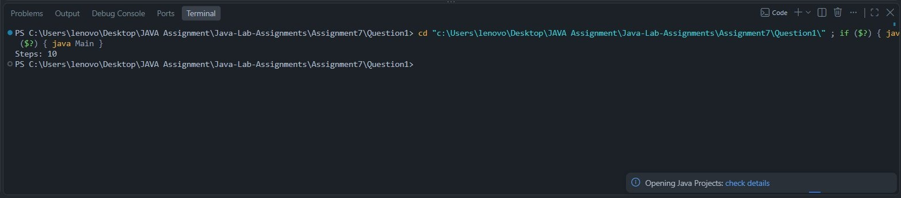
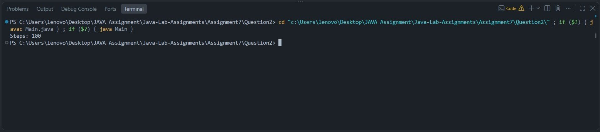
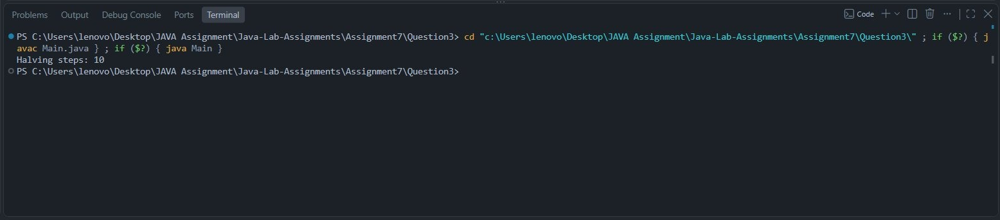

# Assignment 7: Counting Steps and Complexity

**Objective:** Count the steps a program takes, and write its time complexity as a comment.

**Tasks:** 3

## Questions

### Task 1: Question 1

Use one loop that runs from 1 to 10, and count its steps. Above the loop, write a comment with its time complexity. Print Steps: followed by the number of steps.

- Java source: [`Task-01/Main.java`](Task-01/Main.java)
- Compiled bytecode: [`Task-01/Main.class`](Task-01/Main.class)
- Output image: [`Task-01/output.png`](Task-01/output.png)



### Task 2: Question 2

Use two loops, one inside the other, that both run from 1 to 10. Count how many times the inner loop body runs. Above the loops, write a comment with their time complexity. Print Steps: followed by the total.

- Java source: [`Task-02/Main.java`](Task-02/Main.java)
- Compiled bytecode: [`Task-02/Main.class`](Task-02/Main.class)
- Output image: [`Task-02/output.png`](Task-02/output.png)



### Task 3: Question 3

Store 1024 in an int named n. Use a while loop that halves n until n is 1, and count the divisions. Above the loop, write a comment with its time complexity. Print Halving steps: followed by the count.

- Java source: [`Task-03/Main.java`](Task-03/Main.java)
- Compiled bytecode: [`Task-03/Main.class`](Task-03/Main.class)
- Output image: [`Task-03/output.png`](Task-03/output.png)



## Run a task

Open the task folder (for example, `Task-01`) and run:

```sh
javac Main.java
java Main
```
