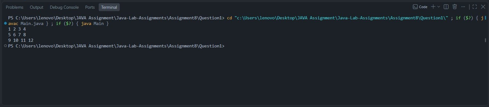
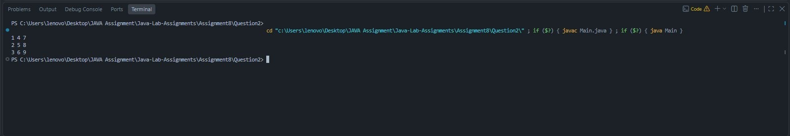
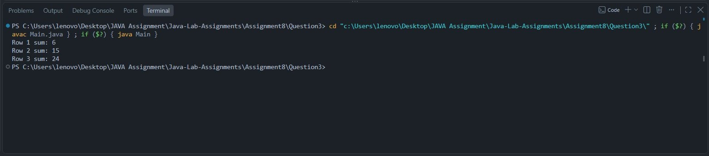

# Assignment 8: Matrices: Transpose and Row Sums

**Objective:** Create two-dimensional arrays, visit them row by row, and build a new matrix from one.

**Tasks:** 3

## Questions

### Task 1: Question 1

Create a matrix named m with 3 rows and 4 columns. Fill it with the values 1 to 12, row by row, using nested loops. Print the matrix one row per line, with a space after each number.

- Java source: [`Task-01/Main.java`](Task-01/Main.java)
- Compiled bytecode: [`Task-01/Main.class`](Task-01/Main.class)
- Output image: [`Task-01/output.png`](Task-01/output.png)



### Task 2: Question 2

Create the 3 by 3 matrix with the rows 1 2 3, 4 5 6 and 7 8 9. Create its transpose (rows and columns swapped). Print the transpose one row per line, with a space after each number.

- Java source: [`Task-02/Main.java`](Task-02/Main.java)
- Compiled bytecode: [`Task-02/Main.class`](Task-02/Main.class)
- Output image: [`Task-02/output.png`](Task-02/output.png)



### Task 3: Question 3

Use the 3 by 3 matrix with the rows 1 2 3, 4 5 6 and 7 8 9. Print the sum of each row, one line per row, in the form Row 1 sum: followed by the total.

- Java source: [`Task-03/Main.java`](Task-03/Main.java)
- Compiled bytecode: [`Task-03/Main.class`](Task-03/Main.class)
- Output image: [`Task-03/output.png`](Task-03/output.png)



## Run a task

Open the task folder (for example, `Task-01`) and run:

```sh
javac Main.java
java Main
```
