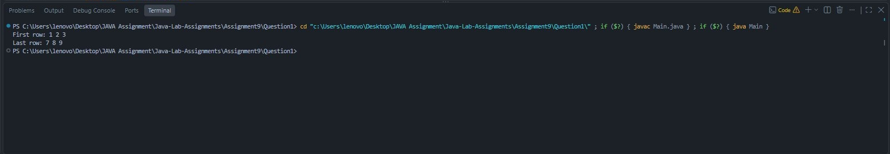
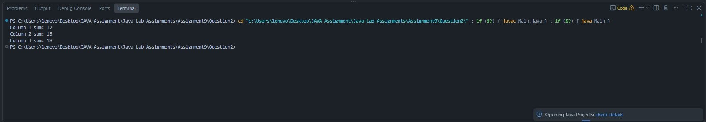
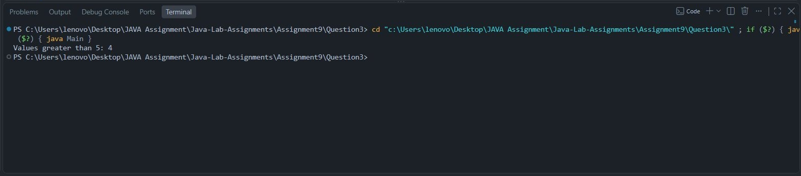

# Assignment 9: Matrices: Rows and Columns

**Objective:** Visit the rows and columns of a matrix with nested loops to print, add and count its values.

**Tasks:** 3

## Questions

### Task 1: Question 1

Use the 3 by 3 matrix with rows 1 2 3, 4 5 6 and 7 8 9. Print First row: and its values, then Last row: and its values, with a space between values.

- Java source: [`Task-01/Main.java`](Task-01/Main.java)
- Compiled bytecode: [`Task-01/Main.class`](Task-01/Main.class)
- Output image: [`Task-01/output.png`](Task-01/output.png)



### Task 2: Question 2

Use the 3 by 3 matrix with the rows 1 2 3, 4 5 6 and 7 8 9. Print the sum of each column, one line per column, in the form Column 1 sum: followed by the total.

- Java source: [`Task-02/Main.java`](Task-02/Main.java)
- Compiled bytecode: [`Task-02/Main.class`](Task-02/Main.class)
- Output image: [`Task-02/output.png`](Task-02/output.png)



### Task 3: Question 3

Use the 3 by 3 matrix with the rows 1 2 3, 4 5 6 and 7 8 9. Count the values greater than 5 and print Values greater than 5: followed by the count.

- Java source: [`Task-03/Main.java`](Task-03/Main.java)
- Compiled bytecode: [`Task-03/Main.class`](Task-03/Main.class)
- Output image: [`Task-03/output.png`](Task-03/output.png)



## Run a task

Open the task folder (for example, `Task-01`) and run:

```sh
javac Main.java
java Main
```
