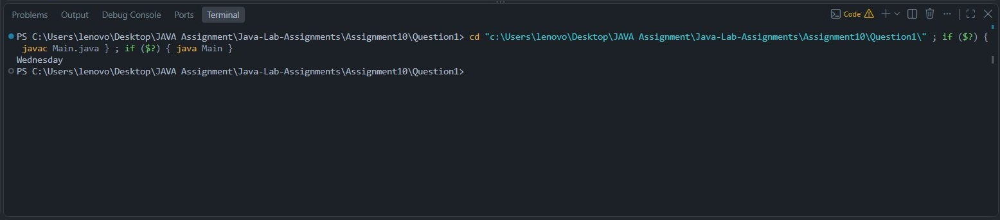
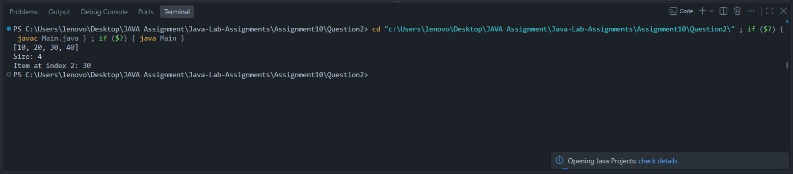
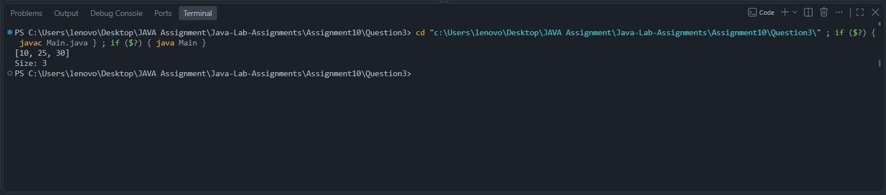

# Assignment 10: Switch and ArrayList

**Objective:** Choose a branch with a switch statement, and store and change a list of numbers in an ArrayList.

**Tasks:** 3

## Questions

### Task 1: Question 1

Store 3 in an int named day. Use a switch statement to print the name of the day: 1 is Monday, 2 is Tuesday and 3 is Wednesday. For any other number, print Invalid day.

- Java source: [`Task-01/Main.java`](Task-01/Main.java)
- Compiled bytecode: [`Task-01/Main.class`](Task-01/Main.class)
- Output image: [`Task-01/output.png`](Task-01/output.png)



### Task 2: Question 2

Create an ArrayList of Integer named list. Add the values 10, 20, 30 and 40. Print the whole list. Then print Size: followed by its size, and Item at index 2: followed by the value at index 2.

- Java source: [`Task-02/Main.java`](Task-02/Main.java)
- Compiled bytecode: [`Task-02/Main.class`](Task-02/Main.class)
- Output image: [`Task-02/output.png`](Task-02/output.png)



### Task 3: Question 3

Create an ArrayList of Integer named list with the values 10, 20, 30 and 40. Use set to change index 1 to 25, and remove to delete index 3. Print the list and Size: followed by its size.

- Java source: [`Task-03/Main.java`](Task-03/Main.java)
- Compiled bytecode: [`Task-03/Main.class`](Task-03/Main.class)
- Output image: [`Task-03/output.png`](Task-03/output.png)



## Run a task

Open the task folder (for example, `Task-01`) and run:

```sh
javac Main.java
java Main
```
