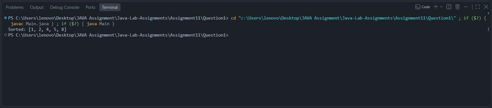
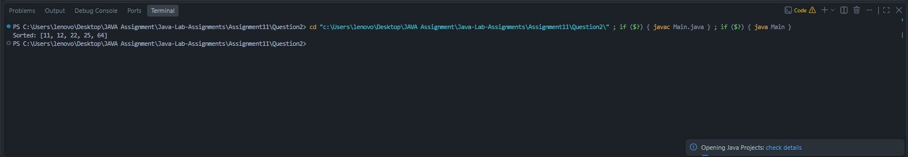
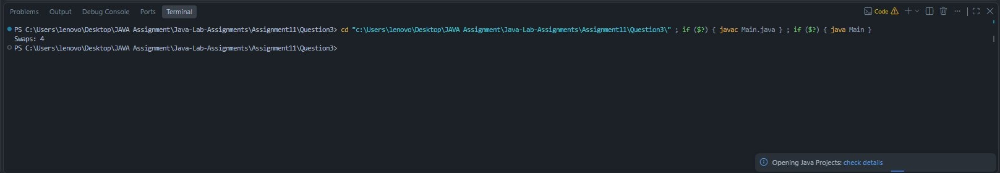

# Assignment 11: Bubble Sort and Selection Sort

**Objective:** Sort small arrays with bubble sort and selection sort, and count the swaps.

**Tasks:** 3

## Questions

### Task 1: Question 1

Create the int array 5, 1, 4, 2, 8. Sort it in increasing order with bubble sort. Print Sorted: followed by the sorted values in square brackets, separated by commas.

- Java source: [`Task-01/Main.java`](Task-01/Main.java)
- Compiled bytecode: [`Task-01/Main.class`](Task-01/Main.class)
- Output image: [`Task-01/output.png`](Task-01/output.png)



### Task 2: Question 2

Create the int array 64, 25, 12, 22, 11. Sort it in increasing order with selection sort. Print Sorted: followed by the sorted values in square brackets, separated by commas.

- Java source: [`Task-02/Main.java`](Task-02/Main.java)
- Compiled bytecode: [`Task-02/Main.class`](Task-02/Main.class)
- Output image: [`Task-02/output.png`](Task-02/output.png)



### Task 3: Question 3

Use the array 5, 1, 4, 2, 8 and sort it with bubble sort. Count the swaps (each time two values change places). Print Swaps: followed by the count.

- Java source: [`Task-03/Main.java`](Task-03/Main.java)
- Compiled bytecode: [`Task-03/Main.class`](Task-03/Main.class)
- Output image: [`Task-03/output.png`](Task-03/output.png)



## Run a task

Open the task folder (for example, `Task-01`) and run:

```sh
javac Main.java
java Main
```
