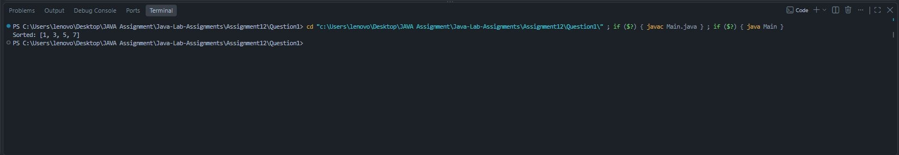
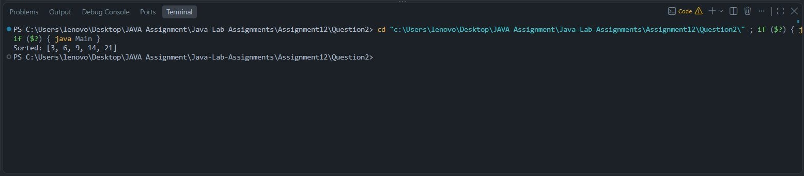
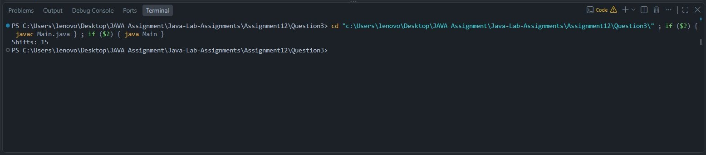

# Assignment 12: Insertion Sort

**Objective:** Sort small arrays with insertion sort and count how many values are shifted.

**Tasks:** 3

## Questions

### Task 1: Question 1

Create the int array 7, 3, 5, 1. Sort it in increasing order with insertion sort. Print Sorted: followed by the sorted values in square brackets, separated by commas.

- Java source: [`Task-01/Main.java`](Task-01/Main.java)
- Compiled bytecode: [`Task-01/Main.class`](Task-01/Main.class)
- Output image: [`Task-01/output.png`](Task-01/output.png)



### Task 2: Question 2

Create the int array 14, 3, 9, 21, 6. Sort it in increasing order with insertion sort. Print Sorted: followed by the sorted values in square brackets, separated by commas.

- Java source: [`Task-02/Main.java`](Task-02/Main.java)
- Compiled bytecode: [`Task-02/Main.class`](Task-02/Main.class)
- Output image: [`Task-02/output.png`](Task-02/output.png)



### Task 3: Question 3

Create the int array 6, 5, 4, 3, 2, 1. Sort it in increasing order with insertion sort. Count the shifts (each time one value moves one place to the right). Print Shifts: followed by the count.

- Java source: [`Task-03/Main.java`](Task-03/Main.java)
- Compiled bytecode: [`Task-03/Main.class`](Task-03/Main.class)
- Output image: [`Task-03/output.png`](Task-03/output.png)



## Run a task

Open the task folder (for example, `Task-01`) and run:

```sh
javac Main.java
java Main
```
