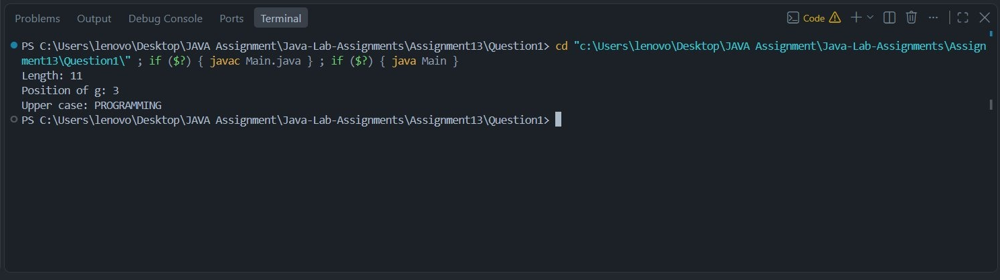
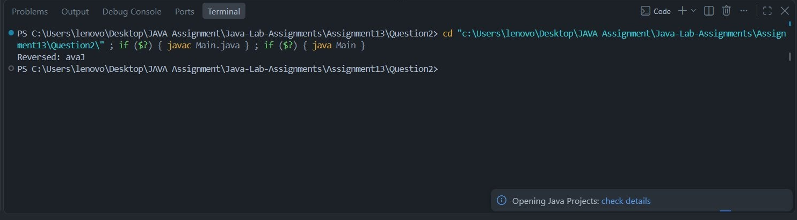
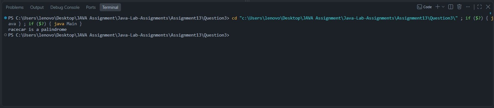
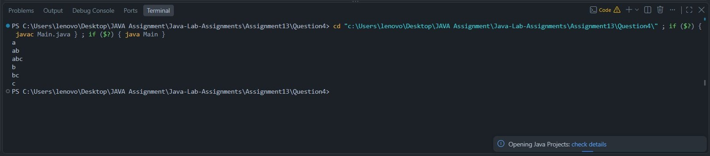

# Assignment 13: Strings: Methods and Palindromes

**Objective:** Use common String methods, reverse a word, check a palindrome and print substrings.

**Tasks:** 4

## Questions

### Task 1: Question 1

Use the word Programming. Print Length: followed by its length, Position of g: followed by the position of the first g (counting from 0), and Upper case: followed by the word in capital letters, using toUpperCase().

- Java source: [`Task-01/Main.java`](Task-01/Main.java)
- Compiled bytecode: [`Task-01/Main.class`](Task-01/Main.class)
- Output image: [`Task-01/output.png`](Task-01/output.png)



### Task 2: Question 2

Reverse the word Java. Build the reversed word one letter at a time, using charAt and + in a loop. Print Reversed: followed by the result.

- Java source: [`Task-02/Main.java`](Task-02/Main.java)
- Compiled bytecode: [`Task-02/Main.class`](Task-02/Main.class)
- Output image: [`Task-02/output.png`](Task-02/output.png)



### Task 3: Question 3

Use the word racecar. Check whether it is a palindrome, which means it reads the same from both ends. Print the word followed by is a palindrome, or followed by is not a palindrome.

- Java source: [`Task-03/Main.java`](Task-03/Main.java)
- Compiled bytecode: [`Task-03/Main.class`](Task-03/Main.class)
- Output image: [`Task-03/output.png`](Task-03/output.png)



### Task 4: Question 4

Use the word abc. Print every substring of it, one on each line, using substring(). For each starting letter from left to right, print its parts from shortest to longest.

- Java source: [`Task-04/Main.java`](Task-04/Main.java)
- Compiled bytecode: [`Task-04/Main.class`](Task-04/Main.class)
- Output image: [`Task-04/output.png`](Task-04/output.png)



## Run a task

Open the task folder (for example, `Task-01`) and run:

```sh
javac Main.java
java Main
```
