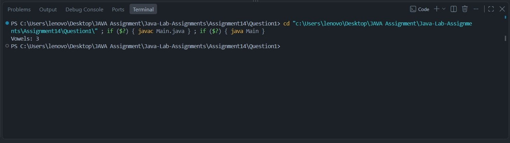
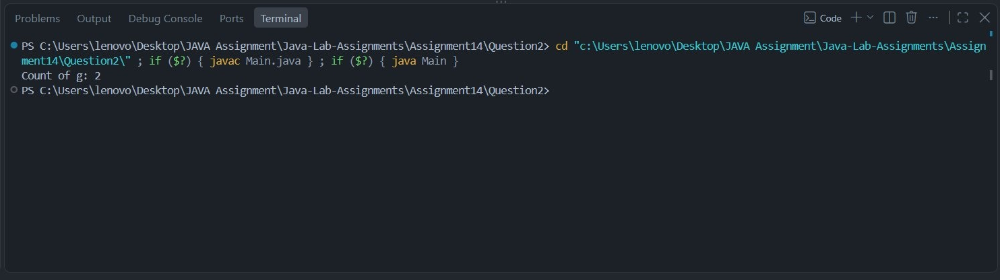
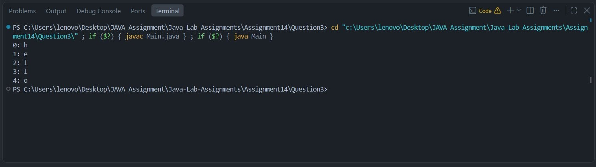

# Assignment 14: Characters: Counting and Positions

**Objective:** Use charAt to count vowels and a letter, and print each letter with its position.

**Tasks:** 3

## Questions

### Task 1: Question 1

Store programming in a String named s. Count its vowels (a, e, i, o and u). Print Vowels: followed by the count.

- Java source: [`Task-01/Main.java`](Task-01/Main.java)
- Compiled bytecode: [`Task-01/Main.class`](Task-01/Main.class)
- Output image: [`Task-01/output.png`](Task-01/output.png)



### Task 2: Question 2

Store programming in a String named s. Count how many times the letter g appears. Print Count of g: followed by the count.

- Java source: [`Task-02/Main.java`](Task-02/Main.java)
- Compiled bytecode: [`Task-02/Main.class`](Task-02/Main.class)
- Output image: [`Task-02/output.png`](Task-02/output.png)



### Task 3: Question 3

Store hello in a String named s. Print each letter on its own line as its position, a colon, a space and the letter. Positions start at 0.

- Java source: [`Task-03/Main.java`](Task-03/Main.java)
- Compiled bytecode: [`Task-03/Main.class`](Task-03/Main.class)
- Output image: [`Task-03/output.png`](Task-03/output.png)



## Run a task

Open the task folder (for example, `Task-01`) and run:

```sh
javac Main.java
java Main
```
