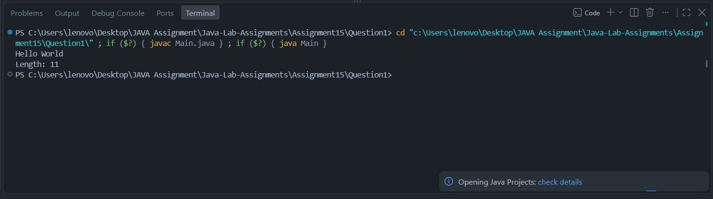
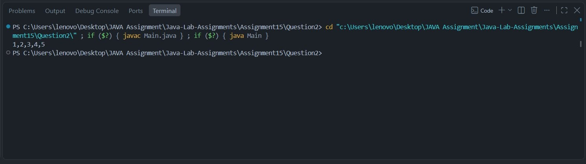
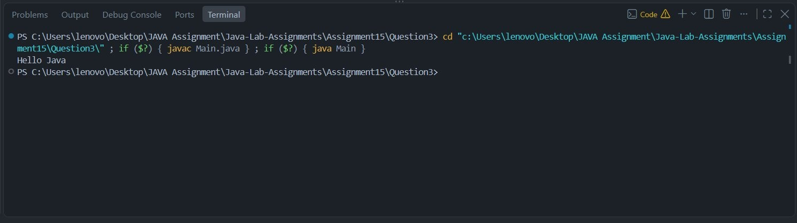

# Assignment 15: StringBuilder Methods

**Objective:** Build and change text with StringBuilder, using append, insert and deleteCharAt.

**Tasks:** 3

## Questions

### Task 1: Question 1

Create a StringBuilder that starts with the text Hello. Append the text " World" to it. Print the StringBuilder, then print Length: followed by its length.

- Java source: [`Task-01/Main.java`](Task-01/Main.java)
- Compiled bytecode: [`Task-01/Main.class`](Task-01/Main.class)
- Output image: [`Task-01/output.png`](Task-01/output.png)



### Task 2: Question 2

Use a StringBuilder. Append each number from 1 to 5, followed by a comma. Then remove the last comma with deleteCharAt. Print the result.

- Java source: [`Task-02/Main.java`](Task-02/Main.java)
- Compiled bytecode: [`Task-02/Main.class`](Task-02/Main.class)
- Output image: [`Task-02/output.png`](Task-02/output.png)



### Task 3: Question 3

Create a StringBuilder that starts with the text Java. Use insert to add the text Hello followed by a space at index 0. Print the StringBuilder.

- Java source: [`Task-03/Main.java`](Task-03/Main.java)
- Compiled bytecode: [`Task-03/Main.class`](Task-03/Main.class)
- Output image: [`Task-03/output.png`](Task-03/output.png)



## Run a task

Open the task folder (for example, `Task-01`) and run:

```sh
javac Main.java
java Main
```
